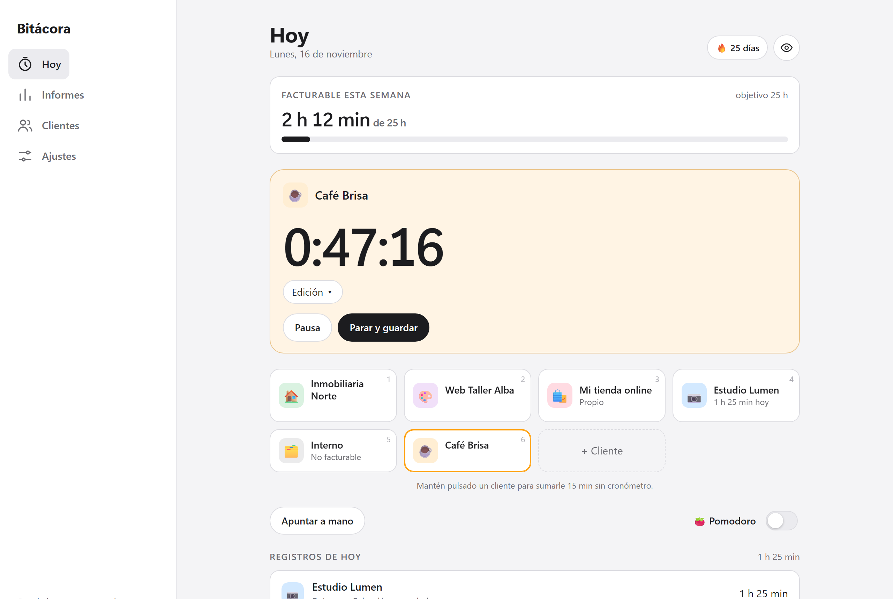
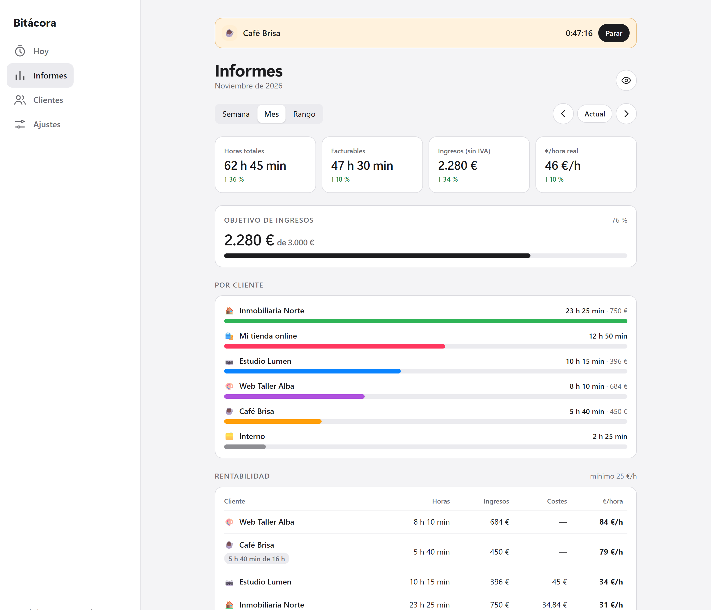
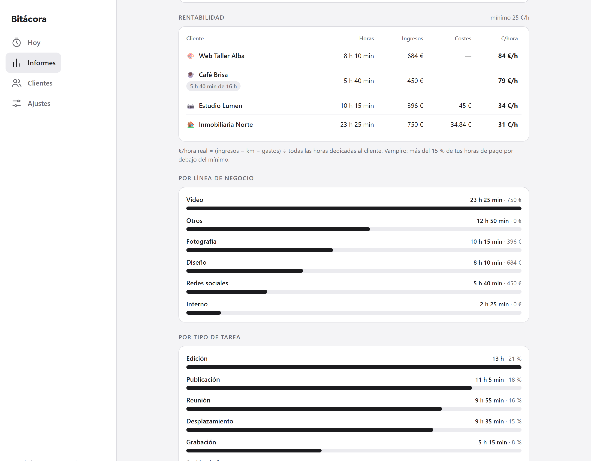
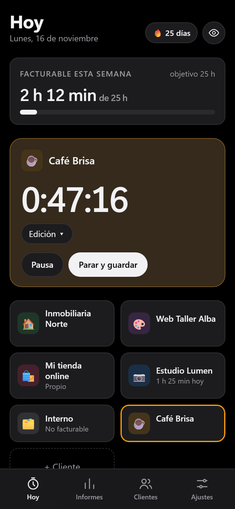
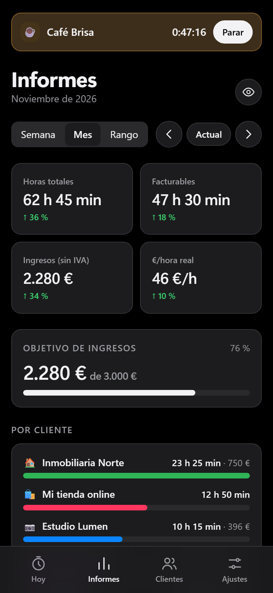
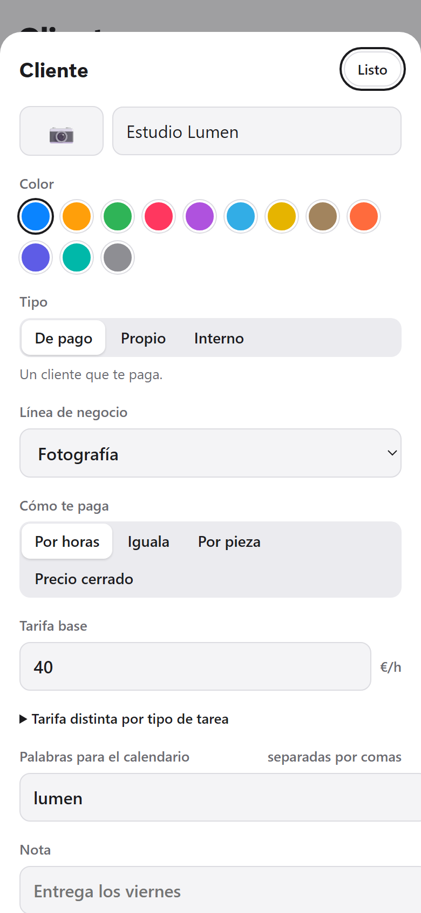

<div align="center">

# Bitácora

**Control de horas por cliente para autónomos y freelances creativos.**
Arrancas el cronómetro con un toque y Bitácora te dice cuánto te deja de verdad cada cliente.

Un solo archivo HTML · Sin instalación · Sin cuentas · Sin servidor · En español




</div>

---

## Por qué existe

La mayoría de autónomos creativos no controla sus horas. No es por pereza: las apps de control de tiempo están pensadas para equipos y consultoras. Te piden proyectos, tareas, etiquetas y formularios largos, y al tercer día se te olvida darle al botón.

El problema es que, sin esas horas, no sabes cuánto ganas por hora con cada cliente. La iguala que parecía buena puede salirte a 12 €/h. El cliente pequeño que no te quita tiempo puede ser el más rentable que tienes.

Bitácora se diseñó al revés:

1. **Apuntar tiene que costar como mucho dos toques.** Un botón por cliente. Si tocas otro, el anterior se para y se guarda solo.
2. **Lo importante es la rentabilidad, no las horas.** Cada cliente cobra a su manera (por horas, iguala, por pieza o precio cerrado) y Bitácora lo traduce todo a un €/hora real.
3. **Si se te olvida, te lo recuerda sin regañarte.** Días en blanco, cronómetros olvidados, días de demasiadas horas: avisos breves y amables, nunca notificaciones pesadas.

## Capturas

<table>
<tr>
<td width="50%"></td>
<td width="50%"></td>
</tr>
<tr>
<td align="center"><sub>Informes del mes, con comparación con el mes anterior</sub></td>
<td align="center"><sub>Rentabilidad real por cliente y por línea de negocio</sub></td>
</tr>
</table>

<p align="center">

&nbsp;

&nbsp;

</p>
<p align="center"><sub>En móvil, con modo oscuro automático, y la ficha de un cliente</sub></p>

## Qué hace

### ⏱️ Apuntar el tiempo

- **Cronómetro en un toque.** Cada cliente tiene su botón, con su color y su emoji. Tocas y empieza a contar. Si tocas otro cliente, el anterior se para y se guarda solo.
- **Pausa** sin cerrar la sesión, por ejemplo para comer. El tiempo en pausa no cuenta.
- **Al parar** aparece una hoja rápida para elegir la tarea y añadir una descripción. Es opcional: si la cierras, el registro se guarda igual.
- **+15 min sin cronómetro.** Mantén pulsado un cliente para sumarle un rato corto, como una llamada o un mensaje.
- **Apuntar a mano.** Atajos de *Hoy* y *Ayer*, duraciones rápidas (15 min, 30 min, 1 h…) o la duración exacta.
- **Piezas entregadas y gastos.** Apunta "2 reels" para un cliente que paga por pieza, o un alquiler de estudio como gasto.
- **Kilómetros.** En las tareas de desplazamiento puedes poner los km, y su coste se descuenta de la rentabilidad del cliente.
- **Pomodoro opcional.** Al terminar el bloque de trabajo, pausa el cronómetro durante el descanso.
- **El tiempo en la pestaña.** Si cambias de pestaña, el título muestra el cronómetro: `▶ 1:24 · Cliente`.

### 💶 Cuatro formas de cobrar

Cada cliente elige la suya, y Bitácora calcula los ingresos del periodo:

| Forma de cobro | Qué configuras | Cómo calcula los ingresos |
|---|---|---|
| **Por horas** | Tarifa base y, si quieres, tarifas distintas por tipo de tarea | Horas facturables × tarifa |
| **Iguala mensual** | Cuota al mes y horas incluidas | La cuota, repartida por días del periodo. Avisa si te pasas de las horas incluidas |
| **Por pieza** | Lista de piezas con precio (Reel 150 €, Sesión 220 €…) | Piezas entregadas × precio |
| **Precio cerrado** | Importe total del encargo | El total, repartido según las horas de cada periodo |

Además hay dos tipos de cliente sin tarifa:

- **Propio:** tus propios negocios. Cuentan tiempo, pero no facturan.
- **Interno:** administración, formación o buscar clientes.

### 📊 Informes

- **Periodos:** semana, mes o rango libre, con flechas para ir hacia atrás y hacia delante.
- **Cifras clave:** horas totales, horas facturables, ingresos sin IVA y €/hora real, con la diferencia respecto al periodo anterior (↑ 12 %).
- **Objetivo de ingresos del mes** con barra de progreso.
- **Desgloses:**
  - Horas y € por cliente.
  - Por línea de negocio (fotografía, vídeo, redes, diseño…).
  - Por tipo de tarea, para saber cuánto editas frente a cuánto grabas.
- **Evolución semanal** de las últimas 12 semanas, con la línea de tu objetivo.
- **Mapa de calor** de días trabajados de las últimas 18 semanas.
- **Cobros del mes:** cada cliente en estado *pendiente → facturado → cobrado*, con el total pendiente y lo que te deben de meses anteriores.
- **Exportar a Excel (CSV)**, con separador `;` y decimales con coma, para que Excel en español lo abra bien.

### 🧛 Rentabilidad real y «clientes vampiro»

```
€/hora real = (ingresos − coste de km − gastos) ÷ todas las horas dedicadas al cliente
```

Cuentan **todas** las horas, también las no facturables: si un cliente te hace ir a tres reuniones que no cobras, eso baja su €/hora.

Bitácora ordena a los clientes del más rentable al menos rentable y los etiqueta:

- **Bajo el mínimo:** su €/hora real está por debajo del mínimo que tú fijas (por defecto, 25 €/h).
- **🧛 Vampiro:** está bajo el mínimo **y** se lleva más del 15 % de tus horas de pago. Son los clientes que más te conviene revisar.
- **Falta tarifa:** no le has puesto precio, así que no se puede calcular.

### 🔔 Avisos amables

Aparecen arriba en la pantalla *Hoy*, solo cuando hacen falta:

- 🗓️ **Días en blanco:** días de trabajo de la última semana sin nada apuntado. Un toque los abre para rellenarlos, y otro los marca como libres.
- ⏰ **Cronómetro olvidado:** lleva encendido más de 2 h (configurable). Puedes seguir o decir a qué hora paraste de verdad, y si lo paras sin más te pide la duración real antes de guardarlo.
- ⚠️ **Sobrecarga:** hoy llevas más de 9 h (configurable).
- 📦 **Iguala superada:** un cliente ya ha usado más horas de las incluidas este mes.
- 💶 **Falta tarifa:** hay clientes sin precio.

### 🗓️ Tus días, tus objetivos

- **Días de trabajo:** 5, 6 o 7 por semana, y eliges cuáles. Los días libres no cuentan como días en blanco ni rompen la racha.
- **Vacaciones y festivos:** días sueltos o rangos completos.
- **Objetivos:** horas facturables a la semana, ingresos al mes y €/hora mínimo.
- **Racha** 🔥 de días seguidos apuntando, discreta, arriba a la derecha.
- **Botón de ocultar dinero** 👁️ para cuando enseñas la pantalla a alguien.

### ⌨️ Atajos de teclado

| Tecla | Acción |
|---|---|
| `Espacio` | Arranca el cliente más reciente, o para el cronómetro |
| `1` – `9` | Arranca el cliente de esa posición |
| `N` | Apuntar a mano |
| `Esc` | Cerrar la hoja abierta |

## Empezar en 30 segundos

### Opción 1: en tu ordenador

1. Descarga [`index.html`](index.html).
2. Ábrelo con doble clic.

Tus datos se guardan en ese navegador. No hay que instalar nada ni crear una cuenta.

### Opción 2: tu propia copia en GitHub Pages

1. Haz un **fork** de este repositorio.
2. En tu fork, ve a **Settings → Pages** y elige la rama principal como origen.
3. En un minuto tendrás tu Bitácora en `https://<tu-usuario>.github.io/<repositorio>/`.

Así puedes abrirla también desde el móvil e incluso añadirla a la pantalla de inicio. Los datos de cada dispositivo se guardan en su navegador.

### Opción 3: como artifact de Claude (con sincronización)

[`bitacora.html`](bitacora.html) está preparado para publicarse como artifact en [claude.ai](https://claude.ai). Ahí se activan tres funciones más:

| Función | Qué hace |
|---|---|
| ☁️ **Sincronización** | Los datos se guardan en tu espacio privado del artifact. Puedes arrancar el cronómetro en el móvil y pararlo en el ordenador. |
| 🤖 **Pregúntale a Claude** | Un botón analiza el periodo y te da 3–5 conclusiones con cifras. También puedes preguntarle cosas como «¿qué cliente debería subir de precio?». |
| 📅 **Google Calendar** | Si tienes el conector, revisa tus eventos de los últimos 7 días y te propone apuntar los que coinciden con un cliente, por su nombre o por las palabras clave que pongas en su ficha. Tú confirmas cada uno. |

Fuera de Claude estas tres funciones se ocultan solas y el resto funciona igual.

> **¿Quieres probarla sin meter tus datos?** Pulsa **«Cargar datos de ejemplo»** al abrirla. Cuando acabes, **«Borrar el ejemplo»** lo quita todo.

## Privacidad y datos

- **No hay servidor de Bitácora.** No se envía nada a ningún sitio.
- **En local o en GitHub Pages,** todo se guarda en el `localStorage` de tu navegador. Si borras los datos del navegador, los pierdes. Por eso existe **Ajustes → Descargar copia**.
- **Como artifact de Claude,** los datos van a tu espacio privado (`data/users/<tu-id>/`). Si compartes el artifact con alguien, esa persona tiene su propio espacio y no ve el tuyo.
- **Copia de seguridad:** un archivo JSON con todo, que puedes restaurar en cualquier otra Bitácora desde *Ajustes → Restaurar copia*.
- **Importes siempre sin IVA.** Bitácora no hace facturas: te da el resumen de horas y lo que cobrar, y la factura la haces con tu programa de siempre.

## Cómo está hecha

- **Un único archivo** HTML, CSS y JavaScript sin frameworks ni librerías, de unos 110 KB.
- **Diseño sobrio inspirado en iOS:**
  - Superficies planas con bordes finos.
  - La tipografía del sistema (San Francisco en Apple, Segoe en Windows).
  - El color reservado a los clientes.
- **Responsive:** barra de pestañas abajo en el móvil y barra lateral en el escritorio.
- **Modo claro y oscuro automático,** según tu sistema.
- **Accesible:** etiquetas en los controles, foco visible y respeto a `prefers-reduced-motion`.

### Archivos

| Archivo | Para qué |
|---|---|
| `bitacora.html` | El código de la app. Es el formato de los artifacts de Claude (sin `<html>`/`<head>`, se añaden al publicar). |
| `index.html` | La misma app como página completa, para abrir en local o servir en GitHub Pages. **Se genera, no se edita.** |
| `build.sh` | Regenera `index.html` a partir de `bitacora.html`. |
| `docs/` | Capturas para este README. |

### Hacer cambios

```sh
# 1. Edita bitacora.html
# 2. Regenera la versión independiente
sh build.sh
# 3. Pruébala en local
python -m http.server 8000   # y abre http://localhost:8000
```

## Preguntas frecuentes

**¿Puedo usarla en el móvil y en el ordenador a la vez?**
En la versión de GitHub o en local, cada dispositivo guarda sus propios datos. Para sincronizar de verdad, usa la versión de artifact de Claude. También puedes mover tus datos con *Descargar copia* y *Restaurar copia*.

**¿Por qué no redondea las horas a 15 minutos como otras apps?**
Porque el objetivo es saber tu rentabilidad real. Bitácora guarda el tiempo exacto. Si facturas en bloques, aplica el redondeo al hacer la factura.

**¿Hace facturas?**
No, a propósito. Te da el resumen del mes por cliente y el estado de cobro, y la factura la emites con tu programa o tu gestoría.

**Trabajo los sábados. ¿Me va a marcar los domingos como días en blanco?**
Solo si los tienes marcados como día de trabajo. En *Ajustes → Días de trabajo* eliges 5, 6 o 7 días, y cuáles.

**¿Qué pasa si me olvido el cronómetro encendido toda la noche?**
Al volver a abrirla te pregunta si sigues con ello. Si no, le dices a qué hora paraste y guarda solo ese tiempo. Si lo paras sin más, Bitácora ve que ha estado encendido más de la cuenta y te abre el registro para que pongas la duración real. Y si se te pasó, en **Hoy → Días anteriores** puedes corregir o borrar cualquier registro de las últimas dos semanas.

**¿Sirve para equipos?**
No. Está pensada para una persona que trabaja con varios clientes.

## Ideas para el futuro

- [ ] Página de solo lectura para que cada cliente vea sus horas del mes, sin cifras de dinero
- [ ] Resumen mensual automático
- [ ] Informe en PDF por cliente
- [ ] Varias monedas

¿Tienes una idea o encontraste un fallo? Abre un *issue*. Los *pull requests* son bienvenidos.

## Licencia

[MIT](LICENSE). Úsala, cámbiala y compártela.

---

<details>
<summary><b>In English</b></summary>

**Bitácora** is a time tracker for freelancers and creative self-employed people who work with several clients. Its interface is in Spanish.

- **One-tap timer.** One button per client. Tapping another client stops and saves the previous one. Long-press a client to add 15 minutes.
- **Four billing models per client:** hourly (with per-task rates), monthly retainer (with included hours), per piece and fixed price. Everything is turned into a **real hourly rate** after mileage and expenses, and clients that eat your time below your minimum rate are flagged as **"vampires"**.
- **Reports** by week, month or custom range: by client, business line and task type, a 12-week trend, a day heatmap and payment status (pending → invoiced → paid).
- **Gentle reminders** for blank workdays, forgotten timers and overload days. Configurable workdays, holidays, goals and a streak counter.
- **Single HTML file**, no dependencies, no server, no account. Data stays in your browser, with JSON backup and restore and CSV export.
- **As a Claude artifact** it also syncs across devices, can ask Claude to analyse your numbers, and suggests entries from Google Calendar.

Download `index.html` and open it, or fork the repository and enable GitHub Pages. MIT licensed.

</details>
